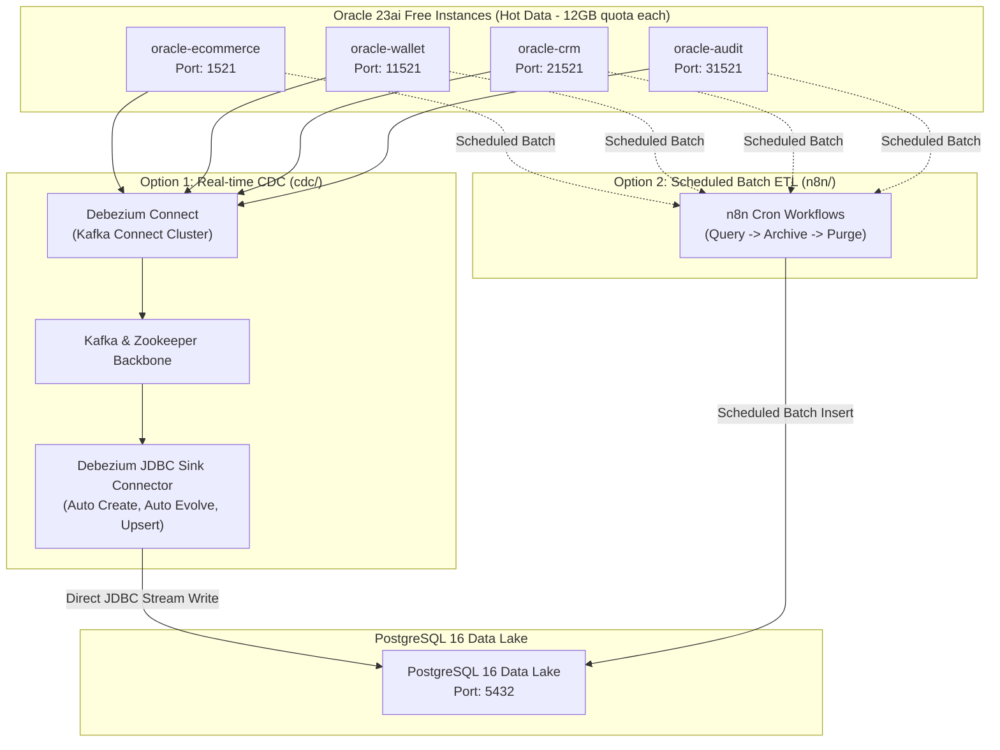

# Oracle 23ai Free to PostgreSQL Data Lake Architecture

โปรเจกต์สถาปัตยกรรมจัดการข้อมูลระดับองค์กรที่เชื่อมต่อ **Oracle 23ai Free** เข้ากับ **PostgreSQL Data Lake** เพื่อแก้ปัญหาข้อจำกัดโควตาพื้นที่ข้อมูล 12 GB ต่อฐานข้อมูลของ Oracle Free Edition

โปรเจกต์นี้แบ่งแนวทางการจัดการข้อมูลออกเป็น 2 รูปแบบตามประเภทของเวิร์กโหลด:
1. **CDC Real-Time Streaming (`cdc/`):** Real-time Change Data Capture ด้วย **Debezium Connect** ร่วมกับ **Debezium JDBC Sink Connector** สตรีมมิ่งข้อมูลการเปลี่ยนแปลง (Insert, Update, Delete) ตรงเข้าสู่ PostgreSQL Data Lake ทันทีโดยไม่ต้องผ่านตัวกลาง n8n
2. **n8n Batch ETL & Lifecycle (`n8n/`):** Scheduled Batch ETL & Data Lifecycle Archiving ด้วย n8n Automation Platform สำหรับงานดึงข้อมูลตามรอบเวลา (Cron Job), Reconciliation, และ Purge ข้อมูล Cold Data ออกจาก Oracle

---

## สถาปัตยกรรมระบบ (Architecture Overview)

สถาปัตยกรรมแบ่งฐานข้อมูล Oracle ออกเป็น 4 Instances แยกตามฟังก์ชันธุรกิจ ทำให้ได้โควตารวม 48 GB (12 GB x 4) สำหรับข้อมูล Hot Data และส่งข้อมูลไปยัง PostgreSQL Data Lake:



---

## การเปรียบเทียบแนวทางทั้งสอง (Comparison)

| ปัจจัย | Debezium Connect + JDBC Sink (`cdc/`) | n8n Batch ETL (`n8n/`) |
|---|---|---|
| **รูปแบบการส่งข้อมูล** | Real-time Streaming (เมื่อมี Transaction เกิดขึ้น) | Scheduled Batch (เช่น รายชั่วโมง/รายวัน) |
| **เทคโนโลยีหลัก** | Debezium Oracle Source + Debezium JDBC Sink | n8n Workflow Scheduler |
| **การส่งลง Data Lake** | เขียนลง PostgreSQL โดยตรง (JDBC Sink) | เขียนลง PostgreSQL ผ่าน Workflow Nodes |
| **การจัดการ Schema** | Auto Create ตาราง และ Auto Evolve คอลัมน์ให้อัตโนมัติ | กำหนด Schema และ Mapping ผ่าน Workflow |
| **ผลกระทบต่อ Oracle** | ต่ำมาก (อ่านจาก Redo Log ผ่าน LogMiner) | ปานกลาง (มี Query SELECT และ DELETE) |
| **เหมาะสำหรับ** | Real-time Sync, Event Streaming, Zero-ETL Ingestion | Data Archiving, Lifecycle Purging, Business Reconciliation |

---

## โครงสร้างโปรเจกต์ (Project Structure)

```
orcl-pg-lake/
|-- cdc/
|   |-- lib/                         # External JARs เช่น ojdbc11.jar
|   |-- oracle-wallet-source.json    # คอนฟิก Source Connector สำหรับ Wallet
|   |-- oracle-ecommerce-source.json # คอนฟิก Source Connector สำหรับ Ecommerce
|   |-- oracle-crm-source.json       # คอนฟิก Source Connector สำหรับ CRM
|   |-- oracle-audit-source.json     # คอนฟิก Source Connector สำหรับ Audit
|   |-- pg-datalake-sink.json        # คอนฟิก Debezium JDBC Sink Connector
|   |-- setup-oracle.sql             # SQL เปิด ARCHIVELOG และตั้งค่า c##dbzuser
|   |-- .env.example
|   |-- README.md                    # คู่มือสถาปัตยกรรม CDC Direct to Data Lake
|   `-- docker-compose.yml           # สแต็ก Oracle x4 + Postgres + Kafka + Debezium Connect
|-- n8n/
|   |-- init-audit/                  # Script สร้างตารางเริ่มต้นสำหรับ Audit Log
|   |-- init-crm/                    # Script สร้างตารางเริ่มต้นสำหรับ CRM
|   |-- init-datalake/               # Script สร้างตารางเริ่มต้นสำหรับ PostgreSQL Data Lake
|   |-- init-ecommerce/              # Script สร้างตารางเริ่มต้นสำหรับ E-Commerce
|   |-- init-wallet/                 # Script สร้างตารางเริ่มต้นสำหรับ Wallet
|   |-- .env.example
|   |-- README.md                    # คู่มือการติดตั้ง n8n Batch ETL และตัวอย่าง Workflow
|-- benchmark/
|   |-- sql/                         # สคริปต์ PL/SQL High-Speed Bulk Inserter
|   |-- load_generator.py            # ตัวยิงโหลด Multi-Process รองรับ 1 ล้าน requests/app
|   |-- monitor_replication.py       # ตัวตรวจสอบ Real-Time Replication Lag
|   `-- README.md                    # คู่มือการทดสอบโหลดและวัดผล Benchmark
|-- .env.example                     # ตัวอย่างค่าตัวแปรระดับ Root
|-- .gitignore                       # ตัดไฟล์ Credentials และ Cache ออกจาก Git
`-- README.md                        # เอกสารภาพรวมโปรเจกต์
```

